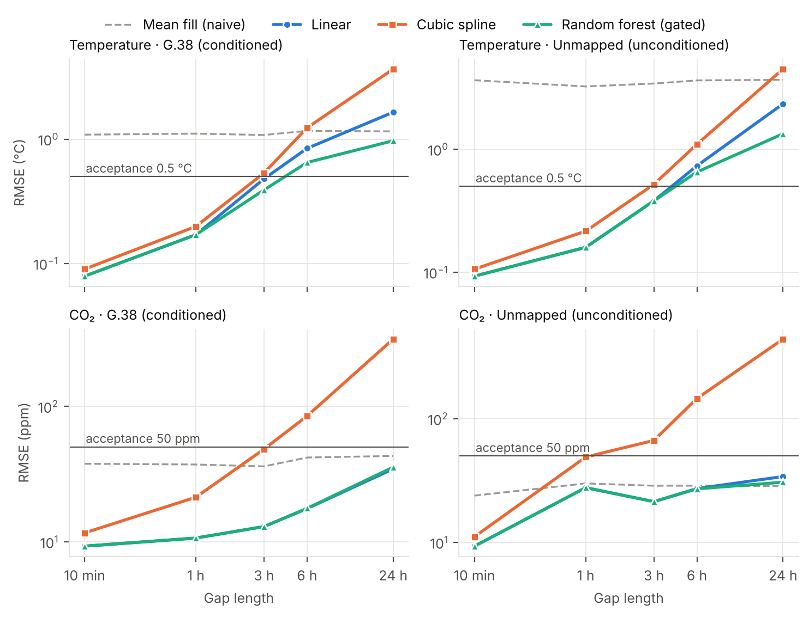

# Reconstructing Missing Indoor Environmental Sensor Data

**MMA3001 Numerical Methods and Machine Learning, Individual Project (Monash University, 2026)**

Building sensors that monitor temperature, CO₂ and humidity feed HVAC control, thermal-comfort
assessment and energy analysis. Real sensors drop readings, go offline, and (as this dataset
shows) re-upload stale data. This project develops and validates methods for **reconstructing
missing sensor readings**, and quantifies how long a gap each method can fill before its error
becomes unacceptable for engineering use.

> **Status:** code complete (data pipeline, interpolation, ML, validation, performance analysis).
> Report complete. Submission ready.

---

## Engineering problem

| | |
|---|---|
| **Context** | Monash Smart Infrastructure environmental sensors, Clayton campus |
| **Problem** | Gaps in 10-minute sensor time series break downstream HVAC/comfort calculations |
| **Intended use** | Fill short-to-medium gaps with a quantified error so the series remains usable |
| **Scope limits** | Two sensors with sufficient data; single-sensor (univariate + cross-variable) reconstruction; no room-level occupancy link (see *Data findings*) |

## Inputs and outputs

**Input:** a 10-minute regular time series for one sensor, with missing samples as `NaN`.

| Variable | Column | Unit | Valid domain |
|---|---|---|---|
| Air temperature | `temperature_C` | °C | 0 – 45 |
| CO₂ concentration | `co2_ppm` | ppm | 350 – 5000 |
| Relative humidity | `humidity_RH` | %RH | 0 – 100 |
| Barometric pressure | `pressure_mb` | mb (hPa) | 950 – 1050 |

Values outside the valid domain are treated as sensor faults and set to `NaN` before processing.

**Output:** the same series with every interior gap filled (same index, units and columns).
Leading/trailing gaps are left as `NaN` (filling them would be extrapolation). The expected
accuracy of a fill depends on the gap length and is reported in `results/ml_comparison_summary.csv`.

**Invalid or unsupported inputs:** non-datetime index → `TypeError`; fewer than two known samples →
`ValueError`; an unrecognised variable or unit in the raw export → `ValueError` (a silent unit change
would corrupt every later calculation); corrupt JSON rows are dropped and counted.

## Methods

| Method | Type | Idea |
|---|---|---|
| Mean fill | naive reference | Fill with the record mean; the "no-skill" yardstick |
| Linear | interpolation (baseline) | Straight line between the neighbouring known samples |
| Cubic spline | interpolation | C² piecewise cubic via an O(n) tridiagonal solve; can overshoot |
| PCHIP | interpolation | Shape-preserving piecewise cubic; never overshoots |
| Akima | interpolation | Locally weighted slopes; fewer wiggles than cubic |
| Ridge / k-NN / Random forest | machine learning | Predict the *correction* to linear interpolation from time of day, weekday/weekend, gap geometry and yesterday's shape; applied only on gap lengths where cross-validation shows it helps ("gating") |

**Validation:** blocks of real data are hidden (10 min – 24 h gaps, 30 gaps × 5 seeds) and
reconstructed; all methods see identical gaps. ML is trained on the first 70 % of each record
(hyperparameters by blocked 5-fold cross-validation) and every method is scored on the last 30 %.
A method passes if RMSE ≤ 0.5 °C / 50 ppm **and** it removes at least half the error of mean fill
(skill ≥ 0.5).

## Key results



- **Higher order is not better:** the cubic spline is the worst method on long gaps and overshoots
  the bracketing values on up to 96 % of filled CO₂ samples; linear and PCHIP never overshoot.
- **Temperature** can be filled acceptably up to **3 h** by any good method; beyond that all fail
  the 0.5 °C criterion.
- **ML helps on long gaps:** the gated random forest cuts 24 h temperature error by ~41–43 %
  relative to linear interpolation, by learning the daily cycle.
- **CO₂** is not predictable from time features in these low-occupancy rooms; ML adds nothing.
- **Performance:** spline fills scale as O(n) (measured log-log slope ≈ 1.0); all methods are
  memory-bound (arithmetic intensity ≈ 0.1–0.3 FLOP/byte). Serial random-forest prediction is
  ~2.5× faster than parallel for typical gap sizes.

## Data findings (audit of the raw export)

The raw export (`5EnvSensor_MayToDec2024_180kRows.csv`, 179,447 rows) required substantial cleaning:

- **76.1 % of rows are stale duplicates.** From mid-June 2024 the gateways repeatedly re-uploaded
  old readings (one reading appears 29,342 times). Rows are de-duplicated on
  `(sensor_id, measurement time)`, *not* upload time.
- **Only 2 of 5 sensors have usable data**, despite the filename's "May to Dec 2024":

  | Sensor | Location | Period | Grid points | Missing |
  |---|---|---|---|---|
  | `6012002000869` | Bldg 60, G.38 (Compactus_upper) | Mar – Jun 2024 | 14,982 | 9.1 % |
  | `6012002000326` | not in location lookup | Sep 2025 – Apr 2026 | 32,568 | 11.3 % |

- **Natural gaps are mostly single dropped samples** (10 min); the longest is 646 samples (~4.5 days).
- **Daylight-saving transitions** make local-time binning ambiguous; gridding is done in UTC.
- **Reproducibility check:** the build script gives identical audit figures (136,604 duplicates,
  76.1 %) on Linux and on Windows.
- **Occupancy data** (9.1 M events, 5 spaces) does not map to either study sensor's room, so it is
  not used as a direct model input.

## Repository structure

```
├── data/
│   ├── README.md          how to obtain the raw data (not committed)
│   ├── raw/               raw Monash exports (git-ignored)
│   └── processed/         generated by scripts/ (git-ignored)
├── docs/                  HTML API documentation (pdoc)
├── results/               audit tables, metrics and figures
├── scripts/               run in order (see Setup and usage)
│   ├── 01_build_clean_dataset.py
│   ├── 02_validate_interpolation.py
│   ├── 03_compare_ml.py
│   ├── 04_profile_performance.py
│   └── 05_make_figures.py
├── src/sensorgap/         the Python package
│   ├── io.py              raw export loading and JSON parsing
│   ├── cleaning.py        de-duplication, bounds, regular grid, gap detection
│   ├── interpolation.py   linear, cubic, PCHIP, Akima and mean-fill methods
│   ├── validation.py      mask-and-reconstruct experiments, metrics, skill
│   └── ml.py              ML residual-correction gap fillers
├── tests/                 pytest unit tests
├── pyproject.toml
├── requirements.txt
└── LICENSE                MIT
```

## Setup and usage

Requires Python ≥ 3.10. Tested on Windows 11 with Anaconda (Python 3.11) and on Linux (Python 3.13).

```bash
git clone https://github.com/n0ah-eng/MMA3001-Project.git
cd MMA3001-Project
conda create -n mma3001 python=3.11 -y
conda activate mma3001
python -m pip install -r requirements.txt
python -m pip install -e .         # installs the sensorgap package (editable)
```

> Use `python -m pip` rather than `pip` so packages install into the same Python
> that runs the scripts. Without the editable install, `pytest` still works
> (it reads `pyproject.toml`) but the scripts fail with
> `ModuleNotFoundError: No module named 'sensorgap'`.

1. Place the raw files in `data/raw/` (see [`data/README.md`](data/README.md)).
2. Run the pipeline (approximate runtimes on a laptop):
   ```bash
   python scripts/01_build_clean_dataset.py     # ~1 min  - clean, audit, grid
   python scripts/02_validate_interpolation.py  # ~10 s   - interpolation study
   python scripts/03_compare_ml.py              # ~4 min  - ML vs interpolation (test period)
   python scripts/04_profile_performance.py     # ~1.5 min - timing, memory, FLOPs
   python scripts/05_make_figures.py            # ~30 s   - report figures
   ```
   All gap placement is seeded, so results are reproducible run to run.
3. Run the tests:
   ```bash
   pytest                                         # quick run
   pytest --html=results/test_report.html         # HTML test report
   ```
4. Generate the API documentation:
   ```bash
   pdoc src/sensorgap -o docs --docformat google
   ```

## AI Usage

**1. What AI Was Used:**

Claude (Anthropic), via claude.ai, October 2026.
Known limitations encountered: the AI occasionally produced confident but incorrect
output, including a test with a wrong expected behaviour (spline overshoot) and an
acceptance threshold that the naive mean fill could already pass. It also tended to
generate code faster and at a higher level of complexity than I could fully follow
line by line, so outputs had to be checked.

**2. How AI Was Used:**

AI was used as a complementary tool to help with data auditing, code development,
explanation of key concepts and functions, liaising ideas and feedback, GitHub
navigation and version control, debugging and troubleshooting, and review of my
report to keep its ideas consistent.
AI-generated code was run, tested and adapted on my own machine, with prompts
iteratively refined when results did not match expectations. Design suggestions
(gap lengths, acceptance criteria, ML gating) were discussed and selected by me,
and AI feedback on the report was reviewed, edited and rewritten in my own words.

**3. Statement of Human Oversight and Responsibility:**

All AI-generated code was verified by running the full pipeline and the 60 automated
pytest tests, including checks against numerical-methods theory (e.g. convergence
order of linear and cubic interpolation). Results were cross-checked against the raw
data and figures, and design suggestions were critically evaluated against the project
brief requirements and best practices. The author is solely responsible for the final
content, accuracy, and conclusions presented in this project, having exercised critical
human judgment and oversight throughout its development.


## License

MIT; see [`LICENSE`](LICENSE). The sensor data is owned by Monash University and is not
redistributed in this repository.
